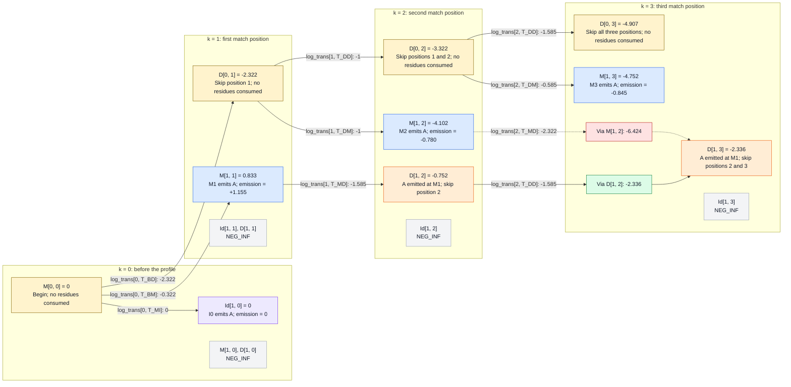

# Viterbi Algorithm: consuming the first residue

With a profile built from `rows = ["AGGCE", "A..CE", "A...E"]`, the goal is to then score a sequence, for example `seq = "AAAA"`. This example shows how the Viterbi algorithm processes the first residue, `A`, step-by-step.

The first outer-loop iteration has `i = 1`, `aa = x[0] = 0`
(encoding A), and visits `k = 0, 1, 2, 3`.

```text
Training column:  1   2   3   4   5
Profile state:   M1  I1  I1  M2  M3
                 A   G   G   C   E
                 A   .   .   C   E
                 A   .   .   .   E
```

Read the chart from left to right as `k` increases. Yellow nodes are initialized
scores at `i = 0`; the other state nodes contain scores at `i = 1`. An arrow from
`i = 0` to `i = 1` emits the first A. A deletion arrow stays at the same `i` and
emits nothing. Each state node shows the code's table entry and its accumulated score.

Green and red boxes show retained and rejected candidates for a particular
destination, before its emission score is added. Dotted arrows mark rejected
candidates. These colors describe the comparison, not whether a source state
is usable elsewhere. All boxes use dark text for contrast.

Arrow labels give the `log_trans` entry and the score added, in bits.
The probability-to-score computations remain [below](#count-and-normalize-the-transitions).



Edge labels show log2 transition probabilities. State node scores are odds
scores in bits, calculated as `previous score + log_trans + emission score`.
For example:

```text
M[1, 1] = M[0, 0] + log_trans[0, T_BM] + _match_odds(0, aa)
        = 0 - 0.322 + 1.155 = 0.833

D[1, 2] = M[1, 1] + log_trans[1, T_MD]
        = 0.833 - 1.585 = -0.752
```

`M[1, 1]` scores aligning the first query A to the first profile match position:

- `M[0, 0] = 0` is the starting score at Begin, before consuming any residue.
  The empty path has probability 1 and score `log2(1) = 0`.
- `log_trans[0, T_BM] = log2(4/5) = -0.322` scores entering M1 from Begin.
  All three training rows take this transition. The alternative Begin-to-D1 does not occur in the training data. Adding the pseudocounts and normalizing these outgoing results in`4 / (4 + 1) = 4/5`.
- `_match_odds(0, aa) = 1.155` scores emitting A at M1 relative to background.
  M1 observes three A residues. With one pseudocount per amino acid,
  `P(A | M1) = (3 + 1) / (3 + 20) = 4/23`. Dividing by the background A
  probability results in `log2((4/23) / 0.078078) = 1.155`; positive because
  A is more likely at M1 than under the background model.

Adding these terms combines the starting path, the transition, and the emission
into a score of `0.833` bits for `B -> M1(A)`.

`Id[1, 1]`, `Id[1, 2]`, and `Id[1, 3]` stay unreachable because their predecessors
`M[0, k]` and `Id[0, k]` are unreachable for those positions. For example,
`M[1, 1] -> I1` would consume a second residue, so it belongs to `i = 2`.
`D[1, 1]` stays unreachable because D1 can only be entered from Begin before
consuming residues; the model has no I0-to-D1 transition.

After finishing `i = 1`, the tables contain:

| Table entry | k = 0 | k = 1 | k = 2 | k = 3 |
|---|---:|---:|---:|---:|
| `M[1, k]` | NEG_INF | 0.833 | -4.102 | -4.752 |
| `Id[1, k]` | 0 | NEG_INF | NEG_INF | NEG_INF |
| `D[1, k]` | NEG_INF | NEG_INF | -0.752 | -2.336 |

Viterbi retains the best path to each cell - for example, the dotted path linking `M[1,2]` to `D[1,3]` is passed over given `D[1,2] -> D[1,3]` - but states remains available for the next iteration (e.g, `M[1, 2]` can play a role in processing the second A).

## Working out the numbers

In the diagram above, each labeled edge adds `log_trans[k, T_...] = log2(p)`, where `p`
is the transition probability learned from the training alignment. An emitting state also adds its emission score;
a delete state adds only the transition score, since this state skips a profile
position without emitting or consuming a query residue. Therefore, no amino
acid emission probability has to be scored.

### Transition probabilities

The three training rows give these paths:

```text
Row 1: AGGCE → B → M1(A) → I1(G) → I1(G) → M2(C) → M3(E)
Row 2: A..CE → B → M1(A) ────────────────→ M2(C) → M3(E)
Row 3: A...E → B → M1(A) ────────────────→ D2    → M3(E)
```

The two middle alignment columns are insert columns. A `.` there contributes
no state or transition. The third row's gap at the M2 column instead produces `D2`.

`trans_counts` starts with one pseudocount per transition. The denominator is
the sum of the smoothed counts for allowed transitions from the same source state.
The order of each list below matches the order in the transition column.

| Source and slot | Transitions | Observed counts | Counts plus one each | Total | Probabilities |
|---|---|---|---|---:|---|
| Begin, 0 | `T_BM`, `T_BD` | 3, 0 | 4, 1 | 5 | 4/5, 1/5 |
| Virtual M0, 0 | `T_MI` | 0 | 1 | 1 | 1 |
| I0, 0 | `T_IM`, `T_II` | 0, 0 | 1, 1 | 2 | 1/2, 1/2 |
| M1, 1 | `T_MM`, `T_MI`, `T_MD` | 1, 1, 1 | 2, 2, 2 | 6 | 1/3, 1/3, 1/3 |
| I1, 1 | `T_IM`, `T_II` | 1, 1 | 2, 2 | 4 | 1/2, 1/2 |
| D1, 1 | `T_DM`, `T_DD` | 0, 0 | 1, 1 | 2 | 1/2, 1/2 |
| M2, 2 | `T_MM`, `T_MI`, `T_MD` | 2, 0, 0 | 3, 1, 1 | 5 | 3/5, 1/5, 1/5 |
| D2, 2 | `T_DM`, `T_DD` | 1, 0 | 2, 1 | 3 | 2/3, 1/3 |

Walking through the table rows with nonzero observations:

- **Begin, slot 0 — `[T_BM, T_BD] = [3, 0]`**
  All three rows start with `M1(A)`, so each contributes one `B → M1`.
  None starts with `D1`.
- **M1, slot 1 — `[T_MM, T_MI, T_MD] = [1, 1, 1]`**
  Row 2 contributes `M1 → M2` (`T_MM`).
  Row 1 contributes `M1 → I1` (`T_MI`).
  Row 3 contributes `M1 → D2` (`T_MD`).
- **I1, slot 1 — `[T_IM, T_II] = [1, 1]`**
  Both observations come from row 1. The first G transitions to the second G
  through `I1 → I1` (`T_II`). After emitting the second G, the path leaves
  for C through `I1 → M2` (`T_IM`). Two G residues therefore give one loop
  and one exit.
- **M2, slot 2 — `[T_MM, T_MI, T_MD] = [2, 0, 0]`**
  Rows 1 and 2 each contribute `M2(C) → M3(E)` (`T_MM`). Row 3 visits `D2`,
  so it contributes nothing to transitions leaving M2.
- **D2, slot 2 — `[T_DM, T_DD] = [1, 0]`**
  Row 3 alone contributes `D2 → M3(E)` (`T_DM`). No row takes `D2 → D3`.

The code normalizes virtual M0's `T_MI` in its own singleton group, separately
from Begin's `T_BM` and `T_BD`; this is why that entry has probability 1.

Computing `log2` gives the transition contributions:

| Code entry | Meaning | Probability | `log_trans` |
|---|---|---:|---:|
| `[0, T_MI]` | Begin via virtual M0 -> I0 | 1 | 0 |
| `[0, T_BM]` | Begin -> M1 | 4/5 | -0.322 |
| `[0, T_BD]` | Begin -> D1 | 1/5 | -2.322 |
| `[0, T_IM]` | I0 -> M1 | 1/2 | -1 |
| `[0, T_II]` | I0 -> I0 | 1/2 | -1 |
| `[1, T_DM]` | D1 -> M2 | 1/2 | -1 |
| `[1, T_DD]` | D1 -> D2 | 1/2 | -1 |
| `[1, T_MD]` | M1 -> D2 | 1/3 | -1.585 |
| `[2, T_DM]` | D2 -> M3 | 2/3 | -0.585 |
| `[2, T_DD]` | D2 -> D3 | 1/3 | -1.585 |
| `[2, T_MD]` | M2 -> D3 | 1/5 | -2.322 |

### Compute the emission contributions

For this iteration, `aa = 0` represents A. Let `b = BACKGROUND_FREQ[aa]`,
approximately `0.078078`. The emission score is `log2(P(A | state) / b)`.

Match states have one pseudocount for each of the 20 amino acids. Insert states
start with `20 * BACKGROUND_FREQ` and have no observations at slot 0 here.

| Code call | Probability of A | Emission score |
|---|---|---:|
| `_match_odds(0, aa)` | M1: (3 observed A + 1) / (3 residues + 20) = 4/23 | +1.155 |
| `_match_odds(1, aa)` | M2: (0 observed A + 1) / (2 residues + 20) = 1/22 | -0.780 |
| `_match_odds(2, aa)` | M3: (0 observed A + 1) / (3 residues + 20) = 1/23 | -0.845 |
| `_insert_odds(0, aa)` | I0: (20 * b) / 20 = b | 0 |


### Before the loop: initialize the deletion prefix

These entries consume no query residues and include no emission contributions:

```text
D[0, 1] = log_trans[0, T_BD]
        = -2.322
D[0, 2] = D[0, 1] + log_trans[1, T_DD]
        = -2.322 - 1 = -3.322
D[0, 3] = D[0, 2] + log_trans[2, T_DD]
        = -3.322 - 1.585 = -4.907
```

### i = 1, k = 0: A leading insertion

```text
cands_i = [M[0, 0] + log_trans[0, T_MI],
           Id[0, 0] + log_trans[0, T_II]]
        = [0 + 0, NEG_INF - 1]
best_i = 0
Id[1, 0] = _insert_odds(0, aa) + best_i = 0 + 0 = 0
```

This path emits the first A at I0. `M[0, 0]` is the virtual starting slot
representing Begin. `M[1, 0]` and `D[1, 0]` remain unreachable.

### i = 1, k = 1: A match at M1

```text
cands = [M[0, 0] + log_trans[0, T_BM],
         Id[0, 0] + log_trans[0, T_IM]]
      = [0 - 0.322, NEG_INF - 1]
best = -0.322
M[1, 1] = _match_odds(0, aa) + best = 1.155 - 0.322 = 0.833
```

`Id[1, 1]` would emit the first query A at I1, so its predecessor must have
consumed zero residues. `M[0, 1]` is unreachable because entering M1 consumes
a residue; `Id[0, 1]` is unreachable because entering I1 also consumes a
residue. For query `AAAA`, the earliest valid path through I1 is
`M1(first A) -> I1(second A)`, reaching `Id[2, 1]`. Both `M[0, 1]` and `Id[0, 1]` therefore remain valued at `NEG_INF`, so the code's `best_i > NI / 2`
check fails and no insert emission is added.
`D[1, 1]` stays unreachable because D1 is only entered from Begin at `i = 0`.

### i = 1, k = 2: A match or deletion at position 2

For the match update, the candidates from `M[0, 1]` and `Id[0, 1]` are
unreachable. The only reachable predecessor is `D[0, 1]`:

```text
best = D[0, 1] + log_trans[1, T_DM] = -2.322 - 1 = -3.322
M[1, 2] = _match_odds(1, aa) + best = -0.780 - 3.322 = -4.102
```

For deletion, use the same query row, because no residue is emitted:

```text
cands_d = [M[1, 1] + log_trans[1, T_MD],
           D[1, 1] + log_trans[1, T_DD]]
        = [0.833 - 1.585, NEG_INF - 1]
D[1, 2] = max(cands_d) = -0.752
```

`Id[1, 2]` remains unreachable: both `M[0, 2]` and `Id[0, 2]` are unreachable.

### i = 1, k = 3: A match or deletion at position 3

For matching, only the predecessor `D[0, 2]` is reachable:

```text
best = D[0, 2] + log_trans[2, T_DM] = -3.322 - 0.585 = -3.907
M[1, 3] = _match_odds(2, aa) + best = -0.845 - 3.907 = -4.752
```

For deletion, two paths reach the same cell. Keep the larger score:

```text
cands_d = [M[1, 2] + log_trans[2, T_MD],
           D[1, 2] + log_trans[2, T_DD]]
        = [-4.102 - 2.322, -0.752 - 1.585]
        = [-6.424, -2.336]
D[1, 3] = max(cands_d) = -2.336
```

`Id[1, 3]` remains unreachable: both `M[0, 3]` and `Id[0, 3]` are unreachable.
