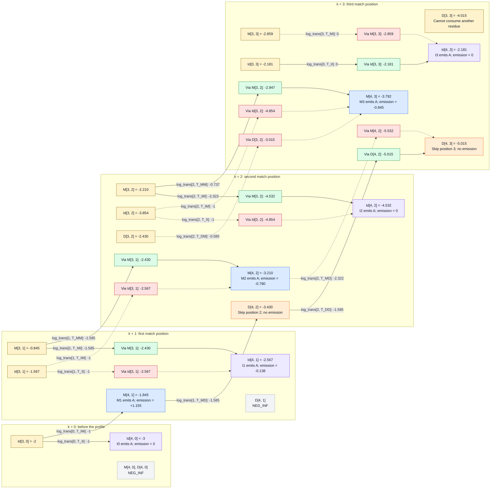

# Viterbi Algorithm: consuming the fourth and final residue

Continue the [third-residue walkthrough](viterbi_third_residue_walkthrough.md)
using the same profile and query:

```python
rows = ["AGGCE", "A..CE", "A...E"]
seq = "AAAA"
L = 4
K = 3
i = 4
aa = x[i - 1]  # x[3] = 0, encoding the fourth A
```

`i` counts consumed query residues; `k` identifies the profile position.
`L = 4` is the query length and `K = 3` is the number of profile match positions.
Match and insert updates read dynamic-programming row `i - 1 = 3` and consume the fourth A.
Delete updates read the current dynamic-programming row `i = 4` and consume nothing.
After visiting `k = 0, 1, 2, 3`, the code compares the complete paths ending
at profile position `K = 3` and returns the highest score.

## Continuing from the third iteration

The previous iteration supplied these scores:

| Table entry | k = 0 | k = 1 | k = 2 | k = 3 |
|---|---:|---:|---:|---:|
| `M[3, k]` | NEG_INF | -0.845 | -2.210 | -2.859 |
| `Id[3, k]` | -2 | -1.567 | -3.854 | -2.181 |
| `D[3, k]` | NEG_INF | NEG_INF | -2.430 | -4.015 |

Read the chart from left to right as `k` increases. Yellow nodes contain
scores from `i = 3`; the other state nodes contain scores at `i = 4`.
Match and insert updates consume the fourth A; deletion updates stay at
the same `i` and consume nothing.

Green and red boxes show retained and rejected candidates for a particular
destination, before its emission score is added. Dotted arrows mark rejected
candidates.

Arrow labels give the `log_trans` entry and the score added, in bits.
The probability-to-score computations remain [below](#transition-and-emission-contributions).



`D[3, 3]` has no outgoing arrow: there is no M4 and this model has no
D3-to-I3 transition, so that path cannot consume the fourth A.

Deletion arrows can skip remaining profile positions after the fourth A.
`D[4, 3]` is now an eligible endpoint because all four query residues have
been consumed and all three profile positions have been matched or skipped.

## Working out the numbers

### Transition probabilities

The probabilities are unchanged from the previous iterations. Each transition
adds `log2(p)` to its predecessor's score:

| Slot | Transition constants | Probability, in order | `log_trans` values |
|---|---|---|---|
| 0 | `T_BM`, `T_MI` | 4/5, 1 | -0.322, 0 |
| 0 | `T_IM`, `T_II` | 1/2, 1/2 | -1, -1 |
| 1 | `T_MM`, `T_MI`, `T_MD` | 1/3, 1/3, 1/3 | -1.585, -1.585, -1.585 |
| 1 | `T_IM`, `T_II` | 1/2, 1/2 | -1, -1 |
| 1 | `T_DM`, `T_DD` | 1/2, 1/2 | -1, -1 |
| 2 | `T_MM`, `T_MI`, `T_MD` | 3/5, 1/5, 1/5 | -0.737, -2.322, -2.322 |
| 2 | `T_IM`, `T_II` | 1/2, 1/2 | -1, -1 |
| 2 | `T_DM`, `T_DD` | 2/3, 1/3 | -0.585, -1.585 |
| 3 | `T_MI`, `T_II` | 1, 1 | 0, 0 |

The [first](viterbi_first_residue_walkthrough.md#transition-probabilities) and [second](viterbi_second_residue_walkthrough.md#transition-probabilities) walkthrough
derives these values from observed counts and pseudocounts.

Let `b = BACKGROUND_FREQ[aa]`, approximately `0.078078`. Emitting A adds
`log2(P(A given state) / b)`:

| Code call | Probability of A | Emission score |
|---|---|---:|
| `_match_odds(0, aa)` | M1: 4/23 | +1.155 |
| `_match_odds(1, aa)` | M2: 1/22 | -0.780 |
| `_match_odds(2, aa)` | M3: 1/23 | -0.845 |
| `_insert_odds(0, aa)` | I0: b | 0 |
| `_insert_odds(1, aa)` | I1: (20 * b) / 22 | -0.138 |
| `_insert_odds(2, aa)` | I2: b | 0 |
| `_insert_odds(3, aa)` | I3: b | 0 |

Only the two G residues in `AGGCE` are assigned to I1 during training
(see [Count and normalize the transitions](viterbi_first_residue_walkthrough.md#count-and-normalize-the-transitions));
the A residues are assigned to M1. I1's A count remains `20 * b`, while its
total count is `20 + 2 = 22`, giving `log2(20/22) = -0.138`.
The other insert slots have no observed residues and emit at background
frequencies, giving an emission score of zero.

The alignment diagrams show only positions reached by each candidate path.
`gap (Dk)` marks a skipped match position and consumes no query residue.

### i = 4, k = 0: a fourth leading insertion

```text
cands_i = [M[3, 0] + log_trans[0, T_MI],
           Id[3, 0] + log_trans[0, T_II]]
        = [NEG_INF + 0, -2 - 1]
best_i = -3
Id[4, 0] = _insert_odds(0, aa) + best_i = 0 - 3 = -3
```

This path inserts all four A residues at I0. It has consumed the query but
has not entered any profile match position. `M[4, 0]` and `D[4, 0]` remain
unreachable.

```text
Profile position:   I0
Training row 1:     no residues
Training row 2:     no residues
Training row 3:     no residues
Query assignment:   first A, second A, third A, fourth A
```

### i = 4, k = 1: match at M1 or insert after M1

For the match update, use predecessors at `i = 3` (with 3 query residues consumed):

```text
cands = [M[3, 0] + log_trans[0, T_BM],
         Id[3, 0] + log_trans[0, T_IM]]
      = [NEG_INF - 0.322, -2 - 1]
best = -3
M[4, 1] = _match_odds(0, aa) + best = 1.155 - 3 = -1.845
```

The path inserts the first three A residues at I0 and matches the fourth at M1.

```text
Profile position:   I0                           M1
Training row 1:     no residues                  A
Training row 2:     no residues                  A
Training row 3:     no residues                  A
Query assignment:   first A, second A, third A   fourth A
```

For insertion at I1:

```text
cands_i = [M[3, 1] + log_trans[1, T_MI],
           Id[3, 1] + log_trans[1, T_II]]
        = [-0.845 - 1.585, -1.567 - 1]
        = [-2.430, -2.567]
best_i = -2.430
Id[4, 1] = _insert_odds(1, aa) + best_i = -0.138 - 2.430 = -2.567
```

Entering I1 from M1 wins over looping from I1. The winning path is
`B -> I0(first A) -> I0(second A) -> M1(third A) -> I1(fourth A)`.

Retained alignment via `M[3, 1]`:

```text
Profile position:   I0                  M1        I1
Training row 1:     no residues         A         G G
Training row 2:     no residues         A         no residues
Training row 3:     no residues         A         no residues
Query assignment:   first A, second A   third A   fourth A
```

Rejected alignment via `Id[3, 1]`:

```text
Profile position:   I0            M1         I1
Training row 1:     no residues   A          G G
Training row 2:     no residues   A          no residues
Training row 3:     no residues   A          no residues
Query assignment:   first A       second A   third A, fourth A
```

`D[4, 1]` remains unreachable: D1 can only be entered from Begin before
consuming residues, and this model has no I0-to-D1 transition.

### i = 4, k = 2: match, insert, or delete at position 2

The match update compares three predecessors at `i = 3, k = 1`.
All three transitions lead to `M[4, 2]` and emit the fourth A:

```text
cands = [M[3, 1] + log_trans[1, T_MM],
         Id[3, 1] + log_trans[1, T_IM],
         D[3, 1] + log_trans[1, T_DM]]
      = [-0.845 - 1.585, -1.567 - 1, NEG_INF - 1]
      = [-2.430, -2.567, NEG_INF]
best = -2.430
M[4, 2] = _match_odds(1, aa) + best = -0.780 - 2.430 = -3.210
```

The winning path is `B -> I0(first A) -> I0(second A) -> M1(third A) -> M2(fourth A)`.

Retained alignment via `M[3, 1]`:

```text
Profile position:   I0                  M1        M2
Training row 1:     no residues         A         C
Training row 2:     no residues         A         C
Training row 3:     no residues         A         gap
Query assignment:   first A, second A   third A   fourth A
```

Rejected alignment via `Id[3, 1]`:

```text
Profile position:   I0            M1         I1            M2
Training row 1:     no residues   A          G G           C
Training row 2:     no residues   A          no residues   C
Training row 3:     no residues   A          no residues   gap
Query assignment:   first A       second A   third A       fourth A
```

For insertion at I2:

```text
cands_i = [M[3, 2] + log_trans[2, T_MI],
           Id[3, 2] + log_trans[2, T_II]]
        = [-2.210 - 2.322, -3.854 - 1]
        = [-4.532, -4.854]
best_i = -4.532
Id[4, 2] = _insert_odds(2, aa) + best_i = 0 - 4.532 = -4.532
```

The winning path is `B -> I0(first A) -> M1(second A) -> M2(third A) -> I2(fourth A)`.

Retained alignment via `M[3, 2]`:

```text
Profile position:   I0            M1         M2        I2
Training row 1:     no residues   A          C         no residues
Training row 2:     no residues   A          C         no residues
Training row 3:     no residues   A          gap       no residues
Query assignment:   first A       second A   third A   fourth A
```

Rejected alignment via `Id[3, 2]`:

```text
Profile position:   M1        M2         I2
Training row 1:     A         C          no residues
Training row 2:     A         C          no residues
Training row 3:     A         gap        no residues
Query assignment:   first A   second A   third A, fourth A
```

For deletion:

```text
cands_d = [M[4, 1] + log_trans[1, T_MD],
           D[4, 1] + log_trans[1, T_DD]]
        = [-1.845 - 1.585, NEG_INF - 1]
D[4, 2] = max(cands_d) = -3.430
```

This extends the path ending at `M[4, 1]` by skipping position 2. All four A
residues have already been consumed, so no emission score is added.

```text
Profile position:   I0                           M1         M2
Training row 1:     no residues                  A          C
Training row 2:     no residues                  A          C
Training row 3:     no residues                  A          gap
Query assignment:   first A, second A, third A   fourth A   gap (D2)
```

### i = 4, k = 3: reach the last profile position

For the match update, use predecessors at `i = 3` (with 3 query residues consumed):

```text
cands = [M[3, 2] + log_trans[2, T_MM],
         Id[3, 2] + log_trans[2, T_IM],
         D[3, 2] + log_trans[2, T_DM]]
      = [-2.210 - 0.737, -3.854 - 1, -2.430 - 0.585]
      = [-2.947, -4.854, -3.015]
best = -2.947
M[4, 3] = _match_odds(2, aa) + best = -0.845 - 2.947 = -3.792
```

This time the predecessor M2 wins. The path is
`B -> I0(first A) -> M1(second A) -> M2(third A) -> M3(fourth A)`.

Retained alignment via `M[3, 2]`:

```text
Profile position:   I0            M1         M2        M3
Training row 1:     no residues   A          C         E
Training row 2:     no residues   A          C         E
Training row 3:     no residues   A          gap       E
Query assignment:   first A       second A   third A   fourth A
```

Rejected alignment via `Id[3, 2]`:

```text
Profile position:   M1        M2         I2            M3
Training row 1:     A         C          no residues   E
Training row 2:     A         C          no residues   E
Training row 3:     A         gap        no residues   E
Query assignment:   first A   second A   third A       fourth A
```

Rejected alignment via `D[3, 2]`:

```text
Profile position:   I0                  M1        M2         M3
Training row 1:     no residues         A         C          E
Training row 2:     no residues         A         C          E
Training row 3:     no residues         A         gap        E
Query assignment:   first A, second A   third A   gap (D2)   fourth A
```

For insertion after M3:

```text
cands_i = [M[3, 3] + log_trans[3, T_MI],
           Id[3, 3] + log_trans[3, T_II]]
        = [-2.859 + 0, -2.181 + 0]
best_i = -2.181
Id[4, 3] = _insert_odds(3, aa) + best_i = 0 - 2.181 = -2.181
```

The loop from `Id[3, 3]` wins. Its path is
`B -> M1(first A) -> D2 -> M3(second A) -> I3(third A) -> I3(fourth A)`.

Retained alignment via `Id[3, 3]`:

```text
Profile position:   M1        M2         M3         I3
Training row 1:     A         C          E          no residues
Training row 2:     A         C          E          no residues
Training row 3:     A         gap        E          no residues
Query assignment:   first A   gap (D2)   second A   third A, fourth A
```

Rejected alignment via `M[3, 3]`:

```text
Profile position:   I0            M1         M2         M3        I3
Training row 1:     no residues   A          C          E         no residues
Training row 2:     no residues   A          C          E         no residues
Training row 3:     no residues   A          gap        E         no residues
Query assignment:   first A       second A   gap (D2)   third A   fourth A
```

For deletion, compare `M[4, 2]` and `D[4, 2]`, both computed at `i = 4, k = 2`:

```text
cands_d = [M[4, 2] + log_trans[2, T_MD],
           D[4, 2] + log_trans[2, T_DD]]
        = [-3.210 - 2.322, -3.430 - 1.585]
        = [-5.532, -5.015]
D[4, 3] = max(cands_d) = -5.015
```

The winning path inserts the first three A residues at I0, matches the fourth
at M1, and skips both remaining match positions:
`B -> I0(first A) -> I0(second A) -> I0(third A) -> M1(fourth A) -> D2 -> D3`.

Retained alignment via `D[4, 2]`:

```text
Profile position:   I0                           M1         M2         M3
Training row 1:     no residues                  A          C          E
Training row 2:     no residues                  A          C          E
Training row 3:     no residues                  A          gap        E
Query assignment:   first A, second A, third A   fourth A   gap (D2)   gap (D3)
```

Rejected alignment via `M[4, 2]`:

```text
Profile position:   I0                  M1        M2         M3
Training row 1:     no residues         A         C          E
Training row 2:     no residues         A         C          E
Training row 3:     no residues         A         gap        E
Query assignment:   first A, second A   third A   fourth A   gap (D3)
```

## Final scores and selection

| Table entry | k = 0 | k = 1 | k = 2 | k = 3 |
|---|---:|---:|---:|---:|
| `M[4, k]` | NEG_INF | -1.845 | -3.210 | -3.792 |
| `Id[4, k]` | -3 | -2.567 | -4.532 | -2.181 |
| `D[4, k]` | NEG_INF | NEG_INF | -3.430 | -5.015 |

The code now evaluates:

```text
terminal = max(M[L, K], Id[L, K], D[L, K])
         = max(M[4, 3], Id[4, 3], D[4, 3])
         = max(-3.792, -2.181, -5.015)
         = -2.181 bits
```

`M[4, 1] = -1.845` has a higher score, but has not covered the entire profile.
To finish that path, positions 2 and 3 must be skipped, giving the lower score
at `D[4, 3]`. The terminal comparison uses only column `K = 3`.

### The winning alignment

The method returns only the score. Following the winning predecessors explains
the alignment responsible for it:

```text
M[0, 0] -> M[1, 1] -> D[1, 2] -> M[2, 3] -> Id[3, 3] -> Id[4, 3]
Begin      first A    no residue  second A    third A     fourth A

Profile state:   M1  M2  M3  I3  I3
Query residue:   A   -   A   A   A
Query index:     1   -   2   3   4
```

The gap skips profile position 2. The two final A residues are insertions
after the third profile match position. All four query residues are consumed,
and all three profile positions are matched or skipped.

| Step | Transition contribution | Emission contribution | Accumulated score |
|---|---:|---:|---:|
| Begin | 0 | None | 0 |
| Begin -> M1(first A) | log2(4/5) = -0.322 | +1.155 | 0.833 |
| M1 -> D2 | log2(1/3) = -1.585 | None | -0.752 |
| D2 -> M3(second A) | log2(2/3) = -0.585 | -0.845 | -2.181 |
| M3 -> I3(third A) | log2(1) = 0 | 0 | -2.181 |
| I3 -> I3(fourth A) | log2(1) = 0 | 0 | -2.181 |

`hmm.viterbi("AAAA")` returns **-2.181099711 bits**, rounded to nine decimal places.
All other displayed scores are rounded to three decimal places, so adding
the displayed approximations may differ in the last digit.
