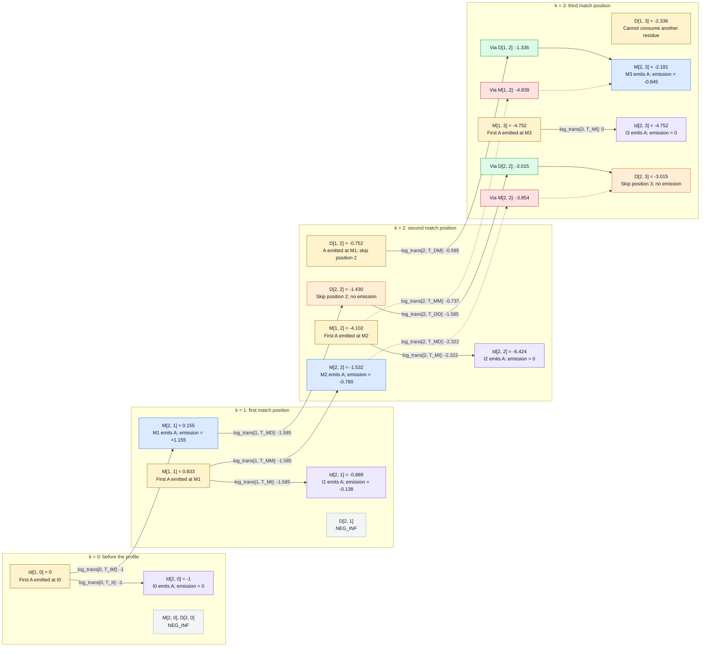

# Viterbi Algorithm: consuming the second residue

For the first part, see the [first-residue walkthrough](viterbi_first_residue_walkthrough.md). The starting point here is:

```python
i = 2
rows = ["AGGCE", "A..CE", "A...E"]
seq = "AAAA"
aa = x[i - 1]  # x[1] = 0, encoding the second A
```

`i` counts query residues consumed; `k` identifies the profile position.
The inner loop visits `k = 0, 1, 2, 3`. Match and insert updates read row
`i - 1 = 1` and consume the second A. Delete updates read the current row
`i = 2` and consume nothing.

## Continuing from the first iteration

The scores computed for the first iteration, where one A was consumed, are:

| Table entry | k = 0 | k = 1 | k = 2 | k = 3 |
|---|---:|---:|---:|---:|
| `M[1, k]` | NEG_INF | 0.833 | -4.102 | -4.752 |
| `Id[1, k]` | 0 | NEG_INF | NEG_INF | NEG_INF |
| `D[1, k]` | NEG_INF | NEG_INF | -0.752 | -2.336 |

The chart should be read from left to right as `k` increases. Yellow nodes contain scores from `i = 1`; the other state nodes contain scores
at `i = 2`. Match and insert arrows consume the second A; deletion arrows
stay at the same `i` and consume nothing.

Green and red boxes show retained and rejected candidates for a particular
destination, before its emission score is added. Dotted arrows mark rejected
candidates. These colors describe the comparison, not whether a source state
is usable elsewhere. All boxes use dark text for contrast.

Arrow labels give the `log_trans` entry and the score added, in bits.
The probability-to-score computations remain [below](#transition-probabilities). Unreachable predecessors are explained below.



For example, the arrow from `M[2, 1]` goes to `D[2, 2]`: it skips profile
position 2 without consuming another A. It does not lead to `Id[2, 1]`.

`D[1, 3]` has no outgoing arrow: there is no M4 and this model has no D3-to-I3
transition, so that path cannot consume the second A.

## Working out the numbers

### Transition probabilities

Each transition count starts with one pseudocount. Probabilities are normalized
within the listed group; for example, M1's outgoing counts `[2, 2, 2]` give
`2/6 = 1/3` each. The following table includes transitions whose source will
turn out to be unreachable at this iteration.

| Source and slot | Transitions, in order | Observed counts | Counts plus one each | Probabilities | `log_trans` values |
|---|---|---|---|---|---|
| Begin, 0 | `T_BM`, `T_BD` | 3, 0 | 4, 1 | 4/5, 1/5 | -0.322, -2.322 |
| Virtual M0, 0 | `T_MI` | 0 | 1 | 1 | 0 |
| I0, 0 | `T_IM`, `T_II` | 0, 0 | 1, 1 | 1/2, 1/2 | -1, -1 |
| M1, 1 | `T_MM`, `T_MI`, `T_MD` | 1, 1, 1 | 2, 2, 2 | 1/3, 1/3, 1/3 | -1.585, -1.585, -1.585 |
| I1, 1 | `T_IM`, `T_II` | 1, 1 | 2, 2 | 1/2, 1/2 | -1, -1 |
| D1, 1 | `T_DM`, `T_DD` | 0, 0 | 1, 1 | 1/2, 1/2 | -1, -1 |
| M2, 2 | `T_MM`, `T_MI`, `T_MD` | 2, 0, 0 | 3, 1, 1 | 3/5, 1/5, 1/5 | -0.737, -2.322, -2.322 |
| I2, 2 | `T_IM`, `T_II` | 0, 0 | 1, 1 | 1/2, 1/2 | -1, -1 |
| D2, 2 | `T_DM`, `T_DD` | 1, 0 | 2, 1 | 2/3, 1/3 | -0.585, -1.585 |
| M3, 3 | `T_MI` | 0 | 1 | 1 | 0 |
| I3, 3 | `T_II` | 0 | 1 | 1 | 0 |


M3's `T_MI` and I3's `T_II` are each normalized in a singleton group in this
implementation, giving probability 1. Begin's `T_BM` is still 4/5, but
`M[1, 0]` is unreachable: a path cannot return to Begin after consuming a residue.

### Emission scores for the second A

The residue is A again, so the match emission scores are unchanged. Let
`b = BACKGROUND_FREQ[aa]`, approximately `0.078078`.

| Code call | Probability of A | Emission score `log2(P(A given state) / b)` |
|---|---|---:|
| `_match_odds(0, aa)` | M1: 4/23 | +1.155 |
| `_match_odds(1, aa)` | M2: 1/22 | -0.780 |
| `_match_odds(2, aa)` | M3: 1/23 | -0.845 |
| `_insert_odds(0, aa)` | I0: b | 0 |
| `_insert_odds(1, aa)` | I1: (20 * b) / 22 | -0.138 |
| `_insert_odds(2, aa)` | I2: b | 0 |
| `_insert_odds(3, aa)` | I3: b | 0 |

I1 becomes reachable in this iteration. Only the two G residues in `AGGCE`
are assigned to I1 during training (see [Count and normalize the transitions](viterbi_first_residue_walkthrough.md#count-and-normalize-the-transitions));
the A residues are assigned to M1.
I1's A count therefore remains `20 * b`, while its total count is `20 + 2 = 22`.
Thus `_insert_odds(1, aa) = log2(20/22) = -0.138`.

### i = 2, k = 0: another leading insertion

```text
cands_i = [M[1, 0] + log_trans[0, T_MI],
           Id[1, 0] + log_trans[0, T_II]]
        = [NEG_INF + 0, 0 - 1]
best_i = -1
Id[2, 0] = _insert_odds(0, aa) + best_i = 0 - 1 = -1
```

The path is `B -> I0(first A) -> I0(second A)`. Both residues occur before the
first match position. `M[2, 0]` and `D[2, 0]` remain unreachable.

```text
Profile position:    I0
Training row 1:      no residues
Training row 2:      no residues
Training row 3:      no residues
Query assignment:    first A, second A
```

The diagrams below show only positions reached by each path. A query entry
such as `gap (D1)` means that profile position was skipped without consuming A.

### i = 2, k = 1: match at M1 or insert after M1

For the match update, the predecessor is I0:

```text
cands = [M[1, 0] + log_trans[0, T_BM],
         Id[1, 0] + log_trans[0, T_IM]]
      = [NEG_INF - 0.322, 0 - 1]
best = -1
M[2, 1] = _match_odds(0, aa) + best = 1.155 - 1 = 0.155
```

This is `B -> I0(first A) -> M1(second A)`: the first A was inserted before
the profile, and the second A matches the first match position M1. This is easier to visualize with the following diagram:

```text
Profile position:   I0       M1
Training data:               A   (all three rows)
Query assignment: first A  second A
```

For the insert update, the predecessor is M1:

```text
cands_i = [M[1, 1] + log_trans[1, T_MI],
           Id[1, 1] + log_trans[1, T_II]]
        = [0.833 - 1.585, NEG_INF - 1]
best_i = -0.752
Id[2, 1] = _insert_odds(1, aa) + best_i = -0.138 - 0.752 = -0.889
```

This is `B -> M1(first A) -> I1(second A)`. Unlike `Id[1, 1]` in the first
iteration, this cell is reachable: one residue has already been consumed at M1.

```text
Profile position:    M1          I1
Training row 1:       A          G G
Training row 2:       A       no residues
Training row 3:       A       no residues
Query assignment: first A     second A
```

`D[2, 1]` remains unreachable. Entering D1 from Begin consumes zero residues,
and the model does not allow I0-to-D1 transitions.

### i = 2, k = 2: match, insert, or delete at position 2

In this instance, there are three possible predecessors for the match state:

```text
cands = [M[1, 1] + log_trans[1, T_MM],
         Id[1, 1] + log_trans[1, T_IM],
         D[1, 1] + log_trans[1, T_DM]]
      = [0.833 - 1.585, NEG_INF - 1, NEG_INF - 1]
best = -0.752
M[2, 2] = _match_odds(1, aa) + best = -0.780 - 0.752 = -1.532
```

The path matches both residues: `B -> M1(first A) -> M2(second A)`.

```text
Profile position:    M1          M2
Training row 1:      A           C
Training row 2:      A           C
Training row 3:      A           gap
Query assignment:    first A     second A
```

The insert update also uses row 1:

```text
cands_i = [M[1, 2] + log_trans[2, T_MI],
           Id[1, 2] + log_trans[2, T_II]]
        = [-4.102 - 2.322, NEG_INF - 1]
best_i = -6.424
Id[2, 2] = _insert_odds(2, aa) + best_i = 0 - 6.424 = -6.424
```

The path is `B -> D1 -> M2(first A) -> I2(second A)`.

```text
Profile position:    M1          M2          I2
Training row 1:      A           C           no residues
Training row 2:      A           C           no residues
Training row 3:      A           gap         no residues
Query assignment:    gap (D1)    first A     second A
```

The delete update uses the `M[2,1]` value computed at `i = 2, k = 1`:

```text
cands_d = [M[2, 1] + log_trans[1, T_MD],
           D[2, 1] + log_trans[1, T_DD]]
        = [0.155 - 1.585, NEG_INF - 1]
D[2, 2] = max(cands_d) = -1.430
```

The path is `B -> I0(first A) -> M1(second A) -> D2`. Both A residues have
already been consumed; deleting position 2 adds no emission score.

```text
Profile position:    I0           M1          M2
Training row 1:      no residues  A           C
Training row 2:      no residues  A           C
Training row 3:      no residues  A           gap
Query assignment:    first A      second A    gap (D2)
```

### i = 2, k = 3: compare two routes into M3

```text
cands = [M[1, 2] + log_trans[2, T_MM],
         Id[1, 2] + log_trans[2, T_IM],
         D[1, 2] + log_trans[2, T_DM]]
      = [-4.102 - 0.737, NEG_INF - 1, -0.752 - 0.585]
      = [-4.839, NEG_INF, -1.336]
best = -1.336
M[2, 3] = _match_odds(2, aa) + best = -0.845 - 1.336 = -2.181
```

The route through `D[1, 2]` wins. It matched the first A at M1 and skipped
position 2: `B -> M1(first A) -> D2 -> M3(second A)`. The other reachable
route, `B -> D1 -> M2(first A) -> M3(second A)`, would have a final score `-5.684 < -2.181` after the M3 emission contribution.

Both candidates reach M3; their assignments differ at positions 1 and 2:

```text
Profile position:    M1          M2          M3
Training row 1:      A           C           E
Training row 2:      A           C           E
Training row 3:      A           gap         E
Query (retained):    first A     gap (D2)    second A
Query (rejected):    gap (D1)    first A     second A
```

For insertion after M3:

```text
cands_i = [M[1, 3] + log_trans[3, T_MI],
           Id[1, 3] + log_trans[3, T_II]]
        = [-4.752 + 0, NEG_INF + 0]
best_i = -4.752
Id[2, 3] = _insert_odds(3, aa) + best_i = 0 - 4.752 = -4.752
```

The path is `B -> D1 -> D2 -> M3(first A) -> I3(second A)`.

```text
Profile position:    M1          M2          M3          I3
Training row 1:      A           C           E           no residues
Training row 2:      A           C           E           no residues
Training row 3:      A           gap         E           no residues
Query assignment:    gap (D1)    gap (D2)    first A     second A
```

For deletion, compare two paths that have already consumed both A residues:

```text
cands_d = [M[2, 2] + log_trans[2, T_MD],
           D[2, 2] + log_trans[2, T_DD]]
        = [-1.532 - 2.322, -1.430 - 1.585]
        = [-3.854, -3.015]
D[2, 3] = max(cands_d) = -3.015
```

Of the two paths, `B -> I0(first A) -> M1(second A) -> D2 -> D3` and `B -> M1(first A) -> M2(second A) -> D3`, the former wins.

Retained alignment at `D[2, 3]`:

```text
Profile position:    I0           M1          M2          M3
Training row 1:      no residues  A           C           E
Training row 2:      no residues  A           C           E
Training row 3:      no residues  A           gap         E
Query assignment:    first A      second A    gap (D2)    gap (D3)
```

Rejected alignment at `D[2, 3]`:

```text
Profile position:    M1          M2          M3
Training row 1:      A           C           E
Training row 2:      A           C           E
Training row 3:      A           gap         E
Query assignment:    first A     second A    gap (D3)
```

## Scores after the second consumption

| Table entry | k = 0 | k = 1 | k = 2 | k = 3 |
|---|---:|---:|---:|---:|
| `M[2, k]` | NEG_INF | 0.155 | -1.532 | -2.181 |
| `Id[2, k]` | -1 | -0.889 | -6.424 | -4.752 |
| `D[2, k]` | NEG_INF | NEG_INF | -1.430 | -3.015 |

These are nine separate reachable endpoints, each retaining its own best path.
There is no overall winner yet as two query A residues remain.  As with `D[1, 3]`, `D[2, 3]` has no way to consume another
residue, so it cannot lead to a complete alignment of this four-residue query.
