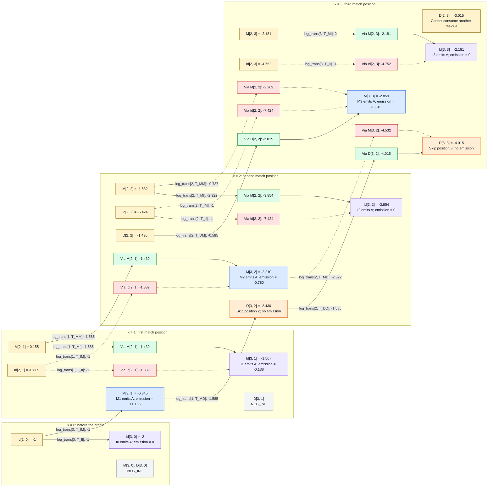

# Viterbi Algorithm: consuming the third residue

Continue the [second-residue walkthrough](viterbi_second_residue_walkthrough.md)
using the same profile and query:

```python
rows = ["AGGCE", "A..CE", "A...E"]
seq = "AAAA"
i = 3
aa = x[i - 1]  # x[2] = 0, encoding the third A
```

`i` counts consumed query residues; `k` identifies the profile position.
Match and insert updates read dynamic-programming row `i - 1 = 2` and consume the third A.
Delete updates read the current dynamic-programming row `i = 3` and consume nothing.

## Continuing from the second iteration

The previous iteration supplied these scores:

| Table entry | k = 0 | k = 1 | k = 2 | k = 3 |
|---|---:|---:|---:|---:|
| `M[2, k]` | NEG_INF | 0.155 | -1.532 | -2.181 |
| `Id[2, k]` | -1 | -0.889 | -6.424 | -4.752 |
| `D[2, k]` | NEG_INF | NEG_INF | -1.430 | -3.015 |

Yellow nodes contain scores from `i = 2`; the other state nodes contain scores at `i = 3`.
Match and insert updates consume the third A; deletion updates stay at
the same `i` and consume nothing.

Green and red boxes show retained and rejected candidates for a particular
destination, before its emission score is added. Dotted arrows mark rejected
candidates.

Arrow labels give the `log_trans` entry and the score added, in bits.
The probability-to-score computations remain [below](#transition-and-emission-contributions).



## Working out the numbers

### Transition and emission contributions

The trained probabilities are unchanged. Each transition adds `log2(p)`:

| Slot | Transition constants | Probability, in order | `log_trans` values |
|---|---|---|---|
| 0 | `T_BM`, `T_MI` | 4/5, 1 | -0.322, 0 |
| 0 | `T_IM`, `T_II` | 1/2, 1/2 | -1, -1 |
| 1 | `T_MM`, `T_MI`, `T_MD` | 1/3, 1/3, 1/3 | -1.585, -1.585, -1.585 |
| 1 | `T_IM`, `T_II` | 1/2, 1/2 | -1, -1 |
| 1 | `T_DM`, `T_DD` | 1/2, 1/2 | -1, -1 |
| 2 | `T_MM`, `T_MI`, `T_MD` | 3/5, 1/5, 1/5 | -0.737, -2.322, -2.322 |
| 2 | `T_IM`, `T_II` | 1/2, 1/2 | -1, -1 |
| 2 | `T_DM`, `T_DD` | 2/3, 1/3 | -0.585, -1.585 |
| 3 | `T_MI`, `T_II` | 1, 1 | 0, 0 |

These are the same counts and normalization groups derived in the
[previous walkthrough](viterbi_second_residue_walkthrough.md#transition-probabilities).
For example, I1 has one observed transition to M2 and one observed loop (both in the first training row).
Adding one pseudocount to each gives `[2, 2]`, so both probabilities are `1/2`.
At slot 3, `T_MI` and `T_II` each belong to their own singleton group.

Let `b = BACKGROUND_FREQ[aa]`, approximately `0.078078`. Emitting A adds
`log2(P(A given state) / b)`:

| Code call | Probability of A | Emission score |
|---|---|---:|
| `_match_odds(0, aa)` | M1: 4/23 | +1.155 |
| `_match_odds(1, aa)` | M2: 1/22 | -0.780 |
| `_match_odds(2, aa)` | M3: 1/23 | -0.845 |
| `_insert_odds(0, aa)` | I0: b | 0 |
| `_insert_odds(1, aa)` | I1: (20 * b) / 22 | -0.138 |
| `_insert_odds(2, aa)` | I2: b | 0 |
| `_insert_odds(3, aa)` | I3: b | 0 |

Only the two G residues in `AGGCE` are assigned to I1 during training
(see [Count and normalize the transitions](viterbi_first_residue_walkthrough.md#count-and-normalize-the-transitions));
the A residues are assigned to M1. I1's A count remains `20 * b`, while its
total count is `20 + 2 = 22`, giving `log2(20/22) = -0.138`.

The alignment diagrams show only positions reached by each candidate path.
`gap (Dk)` marks a skipped match position and consumes no query residue.
Each diagram assigns the first three query A residues.

### i = 3, k = 0: a third leading insertion

```text
cands_i = [M[2, 0] + log_trans[0, T_MI],
           Id[2, 0] + log_trans[0, T_II]]
        = [NEG_INF + 0, -1 - 1]
best_i = -2
Id[3, 0] = _insert_odds(0, aa) + best_i = 0 - 2 = -2
```

The path is `B -> I0(first A) -> I0(second A) -> I0(third A)`.
No profile match position has been visited. `M[3, 0]` and `D[3, 0]` remain
unreachable.

```text
Profile position:   I0
Training row 1:     no residues
Training row 2:     no residues
Training row 3:     no residues
Query assignment:   first A, second A, third A
```

### i = 3, k = 1: match at M1 or insert after M1

For the match update, use predecessors at `i = 2` (with 2 query residues consumed):

```text
cands = [M[2, 0] + log_trans[0, T_BM],
         Id[2, 0] + log_trans[0, T_IM]]
      = [NEG_INF - 0.322, -1 - 1]
best = -2
M[3, 1] = _match_odds(0, aa) + best = 1.155 - 2 = -0.845
```

The path inserts the first two A residues at I0, then matches the third at M1.

```text
Profile position:   I0                  M1
Training row 1:     no residues         A
Training row 2:     no residues         A
Training row 3:     no residues         A
Query assignment:   first A, second A   third A
```

For insertion at I1, both predecessors are now reachable:

```text
cands_i = [M[2, 1] + log_trans[1, T_MI],
           Id[2, 1] + log_trans[1, T_II]]
        = [0.155 - 1.585, -0.889 - 1]
        = [-1.430, -1.889]
best_i = -1.430
Id[3, 1] = _insert_odds(1, aa) + best_i = -0.138 - 1.430 = -1.567
```

Entering I1 from `M[2, 1]` wins over looping from `Id[2, 1]`.
The two candidates align the same three query residues differently:

Retained alignment via `M[2, 1]`:

```text
Profile position:   I0            M1         I1
Training row 1:     no residues   A          G G
Training row 2:     no residues   A          no residues
Training row 3:     no residues   A          no residues
Query assignment:   first A       second A   third A
```

Rejected alignment via `Id[2, 1]`:

```text
Profile position:   M1        I1
Training row 1:     A         G G
Training row 2:     A         no residues
Training row 3:     A         no residues
Query assignment:   first A   second A, third A
```

`D[3, 1]` remains unreachable: D1 can only be entered from Begin before
consuming any residues, and the model has no I0-to-D1 transition.

### i = 3, k = 2: match, insert, or delete at position 2

The match update compares three predecessors at `i = 2, k = 1`.
All three transitions lead to `M[3, 2]` and emit the third A:

```text
cands = [M[2, 1] + log_trans[1, T_MM],
         Id[2, 1] + log_trans[1, T_IM],
         D[2, 1] + log_trans[1, T_DM]]
      = [0.155 - 1.585, -0.889 - 1, NEG_INF - 1]
      = [-1.430, -1.889, NEG_INF]
best = -1.430
M[3, 2] = _match_odds(1, aa) + best = -0.780 - 1.430 = -2.210
```

The winning path is `B -> I0(first A) -> M1(second A) -> M2(third A)`.

Retained alignment via `M[2, 1]`:

```text
Profile position:   I0            M1         M2
Training row 1:     no residues   A          C
Training row 2:     no residues   A          C
Training row 3:     no residues   A          gap
Query assignment:   first A       second A   third A
```

Rejected alignment via `Id[2, 1]`:

```text
Profile position:   M1        I1            M2
Training row 1:     A         G G           C
Training row 2:     A         no residues   C
Training row 3:     A         no residues   gap
Query assignment:   first A   second A      third A
```

For insertion at I2:

```text
cands_i = [M[2, 2] + log_trans[2, T_MI],
           Id[2, 2] + log_trans[2, T_II]]
        = [-1.532 - 2.322, -6.424 - 1]
        = [-3.854, -7.424]
best_i = -3.854
Id[3, 2] = _insert_odds(2, aa) + best_i = 0 - 3.854 = -3.854
```

The winning path is `B -> M1(first A) -> M2(second A) -> I2(third A)`.

Retained alignment via `M[2, 2]`:

```text
Profile position:   M1        M2         I2
Training row 1:     A         C          no residues
Training row 2:     A         C          no residues
Training row 3:     A         gap        no residues
Query assignment:   first A   second A   third A
```

Rejected alignment via `Id[2, 2]`:

```text
Profile position:   M1         M2        I2
Training row 1:     A          C         no residues
Training row 2:     A          C         no residues
Training row 3:     A          gap       no residues
Query assignment:   gap (D1)   first A   second A, third A
```

For deletion, use `M[3, 1]` computed at `i = 3, k = 1`:

```text
cands_d = [M[3, 1] + log_trans[1, T_MD],
           D[3, 1] + log_trans[1, T_DD]]
        = [-0.845 - 1.585, NEG_INF - 1]
D[3, 2] = max(cands_d) = -2.430
```

The path is `B -> I0(first A) -> I0(second A) -> M1(third A) -> D2`.
The third A was already consumed at M1, so skipping position 2 adds no emission.

```text
Profile position:   I0                  M1        M2
Training row 1:     no residues         A         C
Training row 2:     no residues         A         C
Training row 3:     no residues         A         gap
Query assignment:   first A, second A   third A   gap (D2)
```

### i = 3, k = 3: compare all three predecessors of M3

```text
cands = [M[2, 2] + log_trans[2, T_MM],
         Id[2, 2] + log_trans[2, T_IM],
         D[2, 2] + log_trans[2, T_DM]]
      = [-1.532 - 0.737, -6.424 - 1, -1.430 - 0.585]
      = [-2.269, -7.424, -2.015]
best = -2.015
M[3, 3] = _match_odds(2, aa) + best = -0.845 - 2.015 = -2.859
```

The path through D2 wins: `B -> I0(first A) -> M1(second A) -> D2 -> M3(third A)`.

Retained alignment via `D[2, 2]`:

```text
Profile position:   I0            M1         M2         M3
Training row 1:     no residues   A          C          E
Training row 2:     no residues   A          C          E
Training row 3:     no residues   A          gap        E
Query assignment:   first A       second A   gap (D2)   third A
```

Rejected alignment via `M[2, 2]`:

```text
Profile position:   M1        M2         M3
Training row 1:     A         C          E
Training row 2:     A         C          E
Training row 3:     A         gap        E
Query assignment:   first A   second A   third A
```

Rejected alignment via `Id[2, 2]`:

```text
Profile position:   M1         M2        I2            M3
Training row 1:     A          C         no residues   E
Training row 2:     A          C         no residues   E
Training row 3:     A          gap       no residues   E
Query assignment:   gap (D1)   first A   second A      third A
```

For insertion after M3:

```text
cands_i = [M[2, 3] + log_trans[3, T_MI],
           Id[2, 3] + log_trans[3, T_II]]
        = [-2.181 + 0, -4.752 + 0]
best_i = -2.181
Id[3, 3] = _insert_odds(3, aa) + best_i = 0 - 2.181 = -2.181
```

The winning path is `B -> M1(first A) -> D2 -> M3(second A) -> I3(third A)`.
Entering I3 from M3 wins over the existing I3 path's self-loop.

Retained alignment via `M[2, 3]`:

```text
Profile position:   M1        M2         M3         I3
Training row 1:     A         C          E          no residues
Training row 2:     A         C          E          no residues
Training row 3:     A         gap        E          no residues
Query assignment:   first A   gap (D2)   second A   third A
```

Rejected alignment via `Id[2, 3]`:

```text
Profile position:   M1         M2         M3        I3
Training row 1:     A          C          E         no residues
Training row 2:     A          C          E         no residues
Training row 3:     A          gap        E         no residues
Query assignment:   gap (D1)   gap (D2)   first A   second A, third A
```

This tentative profile is similar to that observed in Row 1 of the training data.

For deletion, compare `M[3, 2]` and `D[3, 2]`, both computed at `i = 3, k = 2`:

```text
cands_d = [M[3, 2] + log_trans[2, T_MD],
           D[3, 2] + log_trans[2, T_DD]]
        = [-2.210 - 2.322, -2.430 - 1.585]
        = [-4.532, -4.015]
D[3, 3] = max(cands_d) = -4.015
```

The winning path is
`B -> I0(first A) -> I0(second A) -> M1(third A) -> D2 -> D3`.

Retained alignment via `D[3, 2]`:

```text
Profile position:   I0                  M1        M2         M3
Training row 1:     no residues         A         C          E
Training row 2:     no residues         A         C          E
Training row 3:     no residues         A         gap        E
Query assignment:   first A, second A   third A   gap (D2)   gap (D3)
```

Rejected alignment via `M[3, 2]`:

```text
Profile position:   I0            M1         M2        M3
Training row 1:     no residues   A          C         E
Training row 2:     no residues   A          C         E
Training row 3:     no residues   A          gap       E
Query assignment:   first A       second A   third A   gap (D3)
```

## Scores after the third consumption

| Table entry | k = 0 | k = 1 | k = 2 | k = 3 |
|---|---:|---:|---:|---:|
| `M[3, k]` | NEG_INF | -0.845 | -2.210 | -2.859 |
| `Id[3, k]` | -2 | -1.567 | -3.854 | -2.181 |
| `D[3, k]` | NEG_INF | NEG_INF | -2.430 | -4.015 |

The highest-scoring partial path ends at `M[3, 1]`, with score `-0.845`.
This is not a complete alignment as one query A still remains, and the path has only reached profile position 1. `D[3, 3]` cannot continue because no allowed transition from D3 can consume the remaining residue.
